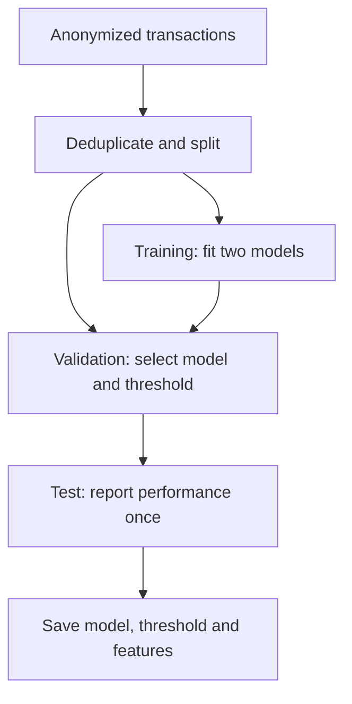

[](https://github.com/Preritsangwan17/Credit-Card-Fraud-Detection/actions/workflows/ci.yml)

# Credit Card Fraud Detection

An end-to-end machine-learning project for detecting fraudulent credit-card transactions in a highly imbalanced dataset. The project compares Logistic Regression and Random Forest, selects the stronger model using validation Average Precision, tunes the classification threshold on validation data, and evaluates the final model once on a held-out test set.


**Project status:** evaluated research baseline for rare-event classification.

[Quick start](#quick-start) · [Results](#reproduced-evaluation) · [Architecture](#model-development-architecture) · [Model card](docs/MODEL_CARD.md) · [Contributing](CONTRIBUTING.md)

## Project highlights

- Removes exact duplicate rows before model development.
- Uses stratified train/validation/test splits so every split preserves the rare fraud class.
- Compares a class-weighted Logistic Regression pipeline with a class-weighted Random Forest.
- Selects the model using Average Precision, which is more informative than accuracy for rare-event detection.
- Tunes the decision threshold by maximizing validation F1 score.
- Saves the trained model, threshold, and required feature order together in one Joblib artifact.
- Includes reusable command-line scripts for training and batch prediction.

## Model-development architecture



## Reproduced evaluation

The recorded experiment uses `src/train.py` on the full dataset with seed 42
and scikit-learn 1.6.1. After deduplication: 170,235 training rows, 56,745 validation rows and
56,746 test rows. The [evaluation record](reports/metrics.json) includes dataset SHA-256 and
runtime versions. The following tables describe the recorded run; the included saved model is the
original notebook artifact. Retrain to create the artifact associated with this benchmark.

### Validation model comparison

| Model | Validation Average Precision |
|---|---:|
| Logistic Regression | 0.7868 |
| Random Forest | **0.8488** |

Random Forest was selected. The validation-tuned decision threshold was `0.4796291900916881`.

### Final held-out test results

| Metric | Score |
|---|---:|
| Accuracy | 0.999383 |
| Precision | **0.884615** |
| Recall | **0.726316** |
| F1 score | **0.797688** |
| Average Precision | **0.770114** |

Final confusion matrix:

| | Predicted genuine | Predicted fraud |
|---|---:|---:|
| Actual genuine | 56,642 | 9 |
| Actual fraud | 26 | 69 |

Accuracy is shown for completeness, but it is not the main success metric because genuine transactions greatly outnumber frauds. Precision, recall, F1, Average Precision, and the confusion matrix give the more meaningful picture.

## Repository structure

| Path | Purpose |
|---|---|
| `src/train.py` | Model comparison, threshold selection and held-out evaluation |
| `src/predict.py` | Batch prediction with the saved feature schema |
| `notebooks/` | Original step-by-step exploration |
| `models/` | Saved notebook artifact and artifact documentation |
| `reports/metrics.json` | Reproduced evaluation with dataset fingerprint |
| `examples/` | Illustrative input rows for the prediction command |
| `data/README.md` | Dataset download instructions |
| `tests/` | Training, prediction and schema regression checks |

## Dataset

This project uses the public **Credit Card Fraud Detection** dataset published on Kaggle by the Machine Learning Group at Université Libre de Bruxelles. It contains anonymized PCA features `V1`–`V28`, plus `Time`, `Amount`, and the target `Class` (`0` = genuine, `1` = fraud).

Download it from [Kaggle](https://www.kaggle.com/datasets/mlg-ulb/creditcardfraud) and place the extracted file at:

```text
data/creditcard.csv
```

The CSV is not committed because it is approximately 151 MB and exceeds GitHub's normal 100 MB per-file limit.

## Quick start

```bash
git clone https://github.com/Preritsangwan17/Credit-Card-Fraud-Detection.git
cd Credit-Card-Fraud-Detection
python3 -m venv .venv
source .venv/bin/activate
python -m pip install -r requirements.txt
```

After placing `creditcard.csv` inside `data/`, train and save a fresh model:

```bash
python src/train.py
```

Run predictions on a CSV containing the 30 input features (the target column is optional):

```bash
python src/predict.py --input examples/transactions.csv --output predictions.csv
```

To explore the work step by step:

```bash
jupyter lab notebooks/credit_card_fraud_detection.ipynb
```

## Evaluation limits

- The notebook preserves the original learning sequence, including an early exploratory baseline.
  Its earlier test split overlaps the later experiment; use `src/train.py` for one consistent benchmark.
- Random stratified splits measure this dataset experiment, not future production fraud performance.
  Temporal validation and transaction-group leakage checks are still needed for deployment.
- Threshold tuning maximizes validation F1. A bank would choose a threshold using review capacity,
  false-positive cost, missed-fraud cost and monitored recall.
- Class weighting changes the score distribution. `fraud_probability` is a model score, not a calibrated
  real-world risk estimate.

## Important model note

The included Joblib file was created with scikit-learn 1.6.1. Only load model files from trusted sources because serialized Python artifacts can execute code during loading.

## Verification

```bash
python -m pip install -r requirements-dev.txt
python -m pytest -q
```

The prediction example demonstrates the input contract. Its synthetic rows are not evidence of model accuracy.

## Author

**Prerit Sangwan**  
B.Tech CSE (AI/ML) student  
GitHub: [@Preritsangwan17](https://github.com/Preritsangwan17)


## Model documentation

See the [model card](docs/MODEL_CARD.md) for the intended use, input contract, evaluation method and limitations.
For the recorded numerical environment, install `requirements-repro.txt` in a fresh virtual environment.
